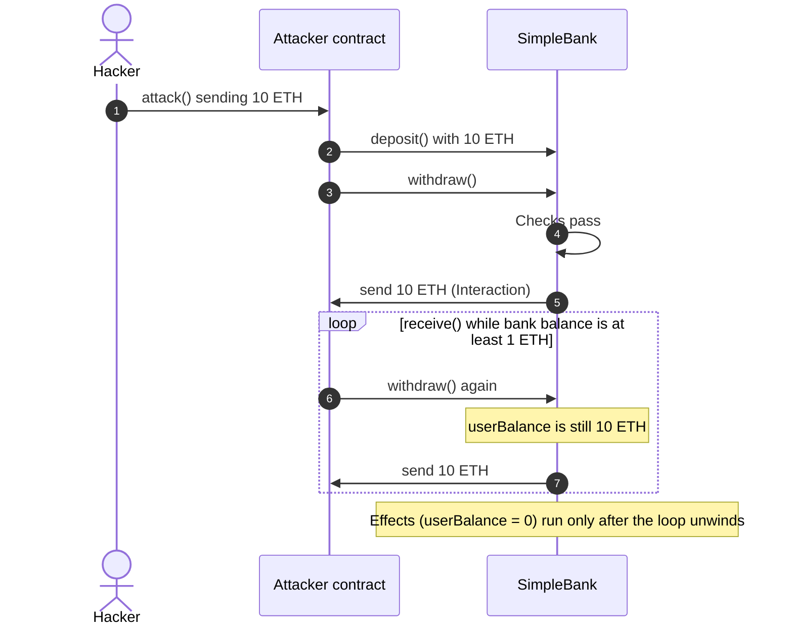
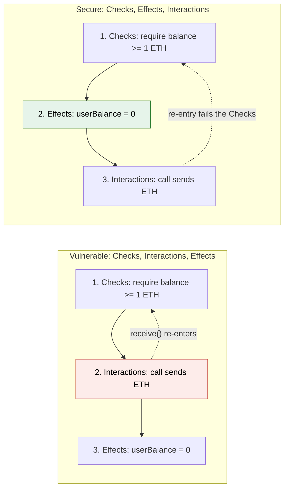
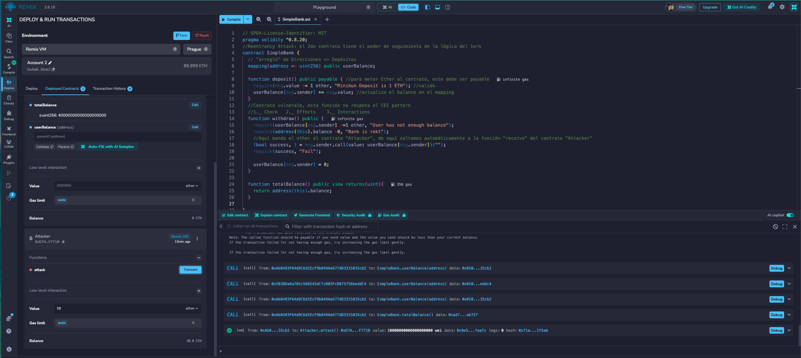

# Reentrancy Attack

A hands-on demo of one of the most famous smart contract vulnerabilities: **reentrancy**. A vulnerable `SimpleBank` contract is drained by a malicious `Attacker` contract because `withdraw()` sends ETH **before** updating the user's balance, breaking the **Checks-Effects-Interactions (CEI)** pattern.

> **Educational purpose only.** This code is intentionally vulnerable. Never deploy it to a real network with real funds.

---

## Table of contents

- [Overview](#overview)
- [Contracts](#contracts)
- [Why it is vulnerable](#why-it-is-vulnerable)
- [Attack flow](#attack-flow)
- [Step-by-step trace](#step-by-step-trace)
- [Vulnerable vs. secure order (CEI)](#vulnerable-vs-secure-order-cei)
- [The fix](#the-fix)
- [Run it yourself in Remix](#run-it-yourself-in-remix)
- [Result](#result)
- [Troubleshooting](#troubleshooting)
- [Key learnings](#key-learnings)
- [Tech](#tech)
- [Possible improvements](#possible-improvements)
- [Related work](#related-work)
- [Author](#author)
- [License](#license)

---

## Overview

Reentrancy happens when a contract makes an external call to an untrusted address **before** it finishes updating its own state. The receiving contract can use that call to jump back into the original function while the state is still outdated, and repeat the action until the funds run out.

This repository contains two contracts in a single file (`SimpleBank.sol`):

| Contract | Role |
| --- | --- |
| `SimpleBank` | Victim. Users deposit ETH (minimum 1 ETH) and withdraw it later. |
| `Attacker` | Malicious contract. Deposits once, then abuses `receive()` to call `withdraw()` repeatedly. |

## Contracts

### SimpleBank (vulnerable)

- `deposit()`: payable, requires at least 1 ETH, and credits the sender in the `userBalance` mapping.
- `withdraw()`: checks the caller's balance, sends the ETH with a low-level `call`, and only **afterwards** sets the balance to 0.
- `totalBalance()`: returns the ETH held by the bank.

### Attacker

- `constructor(address)`: stores the address of the `SimpleBank` to attack.
- `attack()`: payable. Deposits the sent ETH into the bank and immediately calls `withdraw()`.
- `receive()`: runs automatically every time the bank sends ETH to the attacker. If the bank still holds at least 1 ETH, it calls `withdraw()` again.

## Why it is vulnerable

The order of operations inside `withdraw()` is the problem:

```solidity
function withdraw() public {
    // 1. Checks
    require(userBalance[msg.sender] >= 1 ether, "User has not enough balance");
    require(address(this).balance > 0, "Bank is rekt");

    // 3. Interactions (executed too early)
    (bool success, ) = msg.sender.call{value: userBalance[msg.sender]}("");
    require(success, "Fail");

    // 2. Effects (executed too late)
    userBalance[msg.sender] = 0;
}
```

When `call` sends ETH to the `Attacker` contract, Solidity automatically runs its `receive()` function. At that moment `userBalance[attacker]` is **still 10 ETH**, so the second `withdraw()` passes every check again, and so does the third, and so on.

## Attack flow



## Step-by-step trace

Scenario used in the Remix run: the bank already holds **40 ETH** from simulated honest users, and the attacker calls `attack()` with **10 ETH**.

| Step | Action | Bank balance after | Attacker received |
| --- | --- | --- | --- |
| 0 | Initial state | 40 ETH | 0 ETH |
| 1 | `attack()` calls `deposit()` with 10 ETH | 50 ETH | 0 ETH |
| 2 | `withdraw()` #1: checks pass, sends 10 ETH | 40 ETH | 10 ETH |
| 3 | `receive()` re-enters, `withdraw()` #2 | 30 ETH | 20 ETH |
| 4 | `receive()` re-enters, `withdraw()` #3 | 20 ETH | 30 ETH |
| 5 | `receive()` re-enters, `withdraw()` #4 | 10 ETH | 40 ETH |
| 6 | `receive()` re-enters, `withdraw()` #5 | 0 ETH | 50 ETH |
| 7 | Bank balance is below 1 ETH, so `receive()` stops. The five pending `userBalance = 0` lines run while the stack unwinds. | 0 ETH | **50 ETH** |

The attacker put in 10 ETH and walked away with 50 ETH: their own deposit plus the 40 ETH that belonged to other users.

## Vulnerable vs. secure order (CEI)



The CEI pattern says every function should follow this order:

1. **Checks**: validate inputs and conditions (`require`).
2. **Effects**: update the contract's own state.
3. **Interactions**: only then talk to external addresses.

## The fix

Move the state update **before** the external call, and read the amount into a local variable first:

```solidity
function withdraw() public {
    // 1. Checks
    uint256 amount = userBalance[msg.sender];
    require(amount >= 1 ether, "User has not enough balance");
    require(address(this).balance > 0, "Bank is rekt");

    // 2. Effects
    userBalance[msg.sender] = 0;

    // 3. Interactions
    (bool success, ) = msg.sender.call{value: amount}("");
    require(success, "Fail");
}
```

With this order, if the attacker re-enters from `receive()`, `userBalance` is already 0 and the first `require` fails. The inner call reverts, the attacker's `receive()` reverts, the outer `call` returns `false`, and the whole `attack()` transaction is reverted by `require(success, "Fail")`. No funds leave the bank.

For defense in depth, you can also add OpenZeppelin's `ReentrancyGuard` and mark the function `nonReentrant`, or switch to a pull-payment design.

## Run it yourself in Remix

1. Open [Remix IDE](https://remix.ethereum.org) and create `SimpleBank.sol` with the contents of this repo.
2. In **Compile**, build with Solidity `0.8.20` or higher.
3. In **Deploy & Run**, choose the **Remix VM** environment (the run in this repo used the **Prague** fork).
4. Deploy **`SimpleBank`** (it takes no constructor arguments) and copy its address from *Deployed Contracts*.
5. With other accounts, call `deposit()` using a **Value** of 1 ETH or more, so the bank holds funds to steal.
6. Select **`Attacker`**, paste the `SimpleBank` address into `_simpleBankAddress`, and deploy.
7. On the deployed `Attacker`, set **Value** to `10 ether` and click `attack`.
8. Check `SimpleBank.totalBalance()` (it drops to 0) and the `Attacker` contract balance (it grows to 50 ETH).

## Result

Screenshot of the Remix VM after running `attack()` with 10 ETH. The `Attacker` contract balance shows **50.0 ETH**.



## Troubleshooting

Two errors I ran into while reproducing the attack:

- **`invalid address (argument="address", value="")`** when deploying `Attacker`. Its constructor needs the `SimpleBank` address. Deploy `SimpleBank` first and paste its address in `_simpleBankAddress`.
- **`creation of SimpleBank errored: Cannot read properties of undefined (reading 'send')`**. This is an internal Remix error, not a Solidity one. It appeared with the **Osaka** fork selected; switching the Remix VM fork to **Prague** fixed it.

## Key learnings

- External calls hand control to untrusted code. Anything that happens inside `receive()` or `fallback()` of the receiver is outside your control.
- State must be updated **before** any external call: **Checks, Effects, Interactions**.
- `msg.sender.call{value: ...}("")` forwards all available gas, which is what makes the re-entry possible. (`transfer` forwards only 2300 gas, but it is not a safe fix: it can break legitimate contract wallets.)
- A single deposit of 10 ETH was enough to drain 50 ETH, because the loop only stops when the bank runs out of funds.
- Attacks like this are exactly why tests should include a malicious contract that tries to re-enter.

## Tech

- Solidity `^0.8.20` (compiled with `0.8.34` in Remix)
- Remix IDE, Remix VM (Prague)

## Possible improvements

- Add a secure `SimpleBankSecure` contract next to the vulnerable one for a side-by-side comparison.
- Add a Foundry test suite (unit + fuzz) with an attacker contract that proves the exploit on the vulnerable version and the revert on the patched one.
- Add OpenZeppelin `ReentrancyGuard` (`nonReentrant`) as a second layer of protection.
- Replace the push payment with a pull-payment (withdraw pattern).
- Emit events on `deposit()` and `withdraw()`.

## Related work

- [cryptobank-foundry](https://github.com/alchzamb/cryptobank-foundry): reentrancy attack/defense demo with Vulnerable and Safe contracts and a Foundry test suite.

## Author

Based on an educational exercise from the Blockchain Accelerator program. Documentation, step-by-step analysis, and diagrams by Alex Zambrano.

## License

MIT
